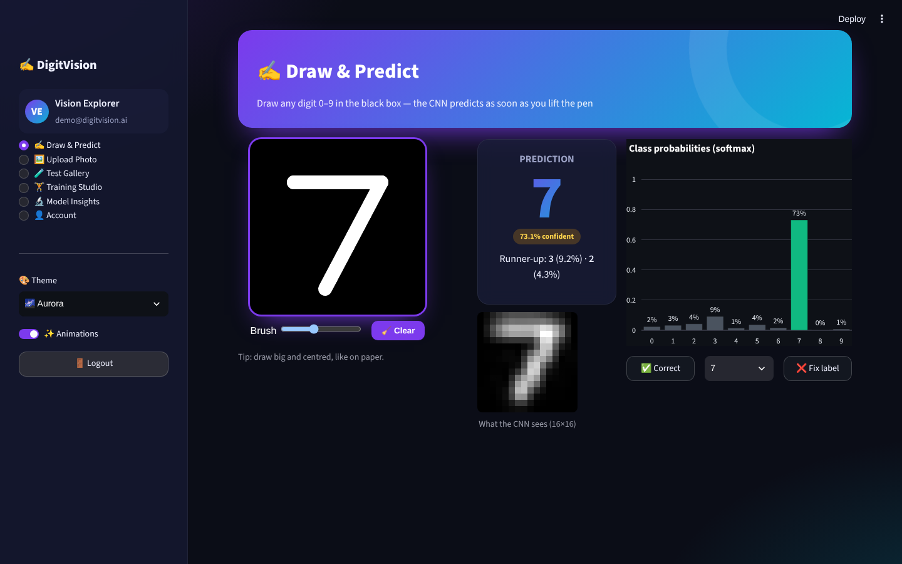
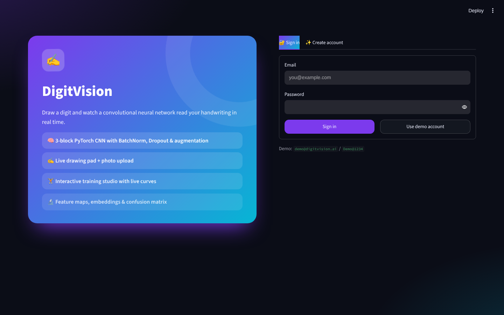
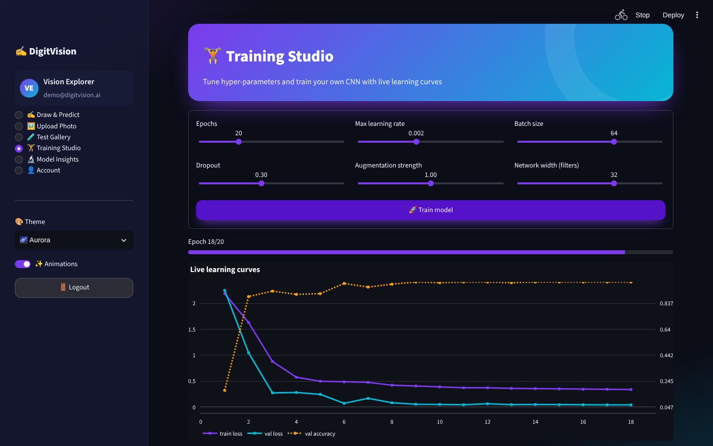
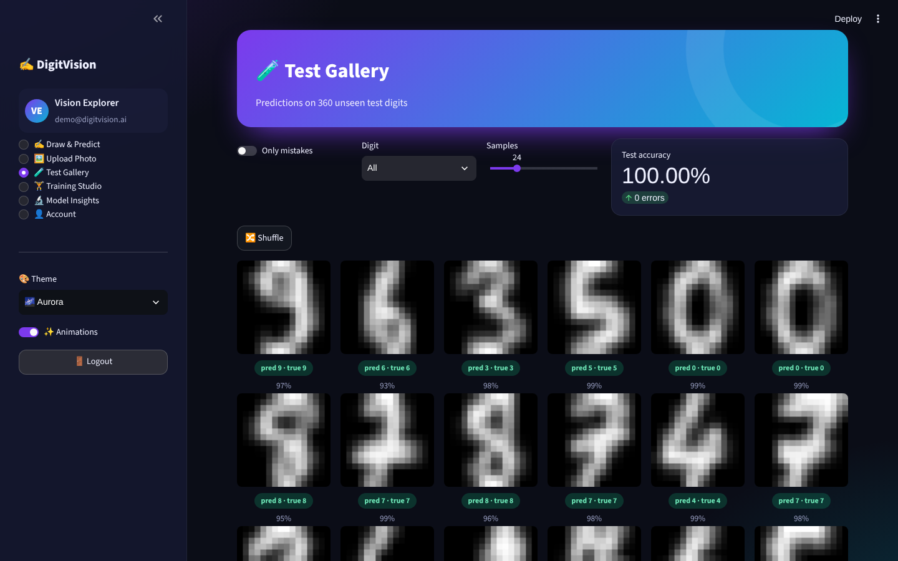
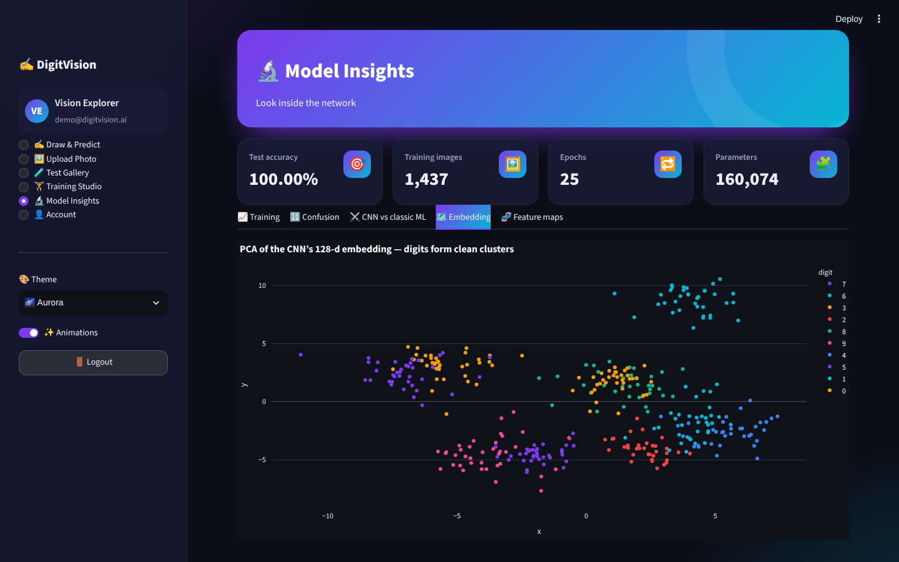

<div align="center">

# ✍️ DigitVision

### Handwritten digit recognition with a PyTorch CNN — live drawing pad, photo upload, training studio & network visualisations


</div>



## ✨ Features

| Module | Highlights |
|---|---|
| 🔐 **Register / Login** | SQLite users, salted **PBKDF2-SHA256** hashing, password-strength meter, validation, demo account, activity log, change password |
| ✍️ **Draw & Predict** | Custom **bidirectional drawing pad** (Streamlit Components v2, mouse & touch, brush size, clear) — the CNN predicts the moment you lift the pen; animated prediction card, softmax bar chart, top-3, model’s-eye 16×16 view, ✅/❌ feedback with live accuracy on *your* handwriting |
| 🖼️ **Upload Photo** | Photo of a digit on paper → grayscale → ink detection (auto-invert) → crop & centre → resize, with every step visualised |
| 🧪 **Test Gallery** | Random unseen test digits with predictions & confidence, filter by digit or *mistakes only*, shuffle |
| 🏋️ **Training Studio** | Tune epochs, learning rate, batch size, dropout, augmentation strength and network width, then train with a **live progress bar and learning curves**; the new model is used app-wide |
| 🔬 **Model Insights** | Accuracy curves, confusion matrix, per-digit accuracy, CNN vs Logistic Regression / k-NN / SVM, **PCA of the 128-d embedding**, convolutional **feature maps** |
| 🎨 **Themes & animations** | 5 colour themes, glassmorphism cards, animated hero, floating icons, page transitions, balloons on training completion, animation toggle |

## 🧠 Model

```
Input 1×16×16
 → Conv3×3(32) → BatchNorm → ReLU → MaxPool      (8×8)
 → Conv3×3(64) → BatchNorm → ReLU → MaxPool      (4×4)
 → Conv3×3(128) → BatchNorm → ReLU → MaxPool     (2×2)
 → Flatten → Dense(128) → Dropout → Dense(10) → Softmax
```

* Data: scikit-learn’s handwritten digits (1,797 images) upsampled to 16×16 — no download needed
* On-the-fly **augmentation**: random rotation, scaling, translation and noise via `affine_grid`
* AdamW + OneCycle learning-rate schedule, label smoothing — ≈99–100 % test accuracy in ~20 s on CPU

## 🖼️ Screenshots

| Login | Training studio | Test gallery | Model insights |
|---|---|---|---|
|  |  |  |  |

## 🚀 Run locally

```bash
git clone https://github.com/PreciousBharath/DIGITVISION-CNN-DIGIT-RECOGNITION.git
cd DIGITVISION-CNN-DIGIT-RECOGNITION
pip install -r requirements.txt
streamlit run app.py
```

Click **Use demo account** (`demo@digitvision.ai` / `Demo@1234`) or create an account. The CNN trains once on first launch (~20 s) and is cached.

## 🧱 Project structure

```
├── app.py              # Streamlit pages
├── core/
│   ├── engine.py       # data, CNN, augmentation, training loop, baselines, preprocessing, feature maps
│   ├── canvas.py       # inline Components-v2 drawing pad (HTML/CSS/JS)
│   ├── auth.py         # SQLite users, PBKDF2 hashing, login/register UI
│   └── ui.py           # themes, animations, KPI cards, Plotly template
├── .streamlit/config.toml
└── requirements.txt
```

## 📄 License

MIT © [Bharath](https://github.com/PreciousBharath)
